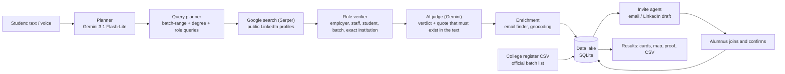

# AlumniAgent: AI-native alumni finder (MVP)

**Ask in plain English or by voice. An AI agent finds the alumni, proves each match, maps them, invites them, and builds a data lake that grows with every search and every alumnus who joins.**

> Example: *"Find alumni from Galgotias University, 2020 to 2026 batches, who work at Google, Microsoft or Oracle. Tell me their location and email, or LinkedIn if no email."*

---

## 1. The problem
Students can't easily find alumni from their college at the companies they're targeting. Colleges also don't have an up-to-date alumni database, because the data goes stale the day students graduate.

## 2. What the MVP does (mapped to the brief)

| Brief requirement | How AlumniAgent delivers it |
|---|---|
| Type **or voice** query | Natural-language search box plus a mic button (Web Speech API). Gemini turns the sentence into `{college, batches, companies}`. |
| College alumni from **batch range** at **Google/Microsoft/Oracle** | Live discovery of public LinkedIn profiles through Google search (Serper API), with batch-range and degree-targeted queries |
| **Location** | Taken from the LinkedIn card, geocoded with OpenStreetMap, and shown on an interactive map |
| **Email, or LinkedIn if none** | Email-finder agent (public GitHub profile, public web; never guessed). Every result has a LinkedIn link. |
| Every run **fills a data lake** | SQLite data lake: each search inserts or refreshes alumni records with source, proof and timestamps |
| **Auto-invite** alumni | Invite agent creates a personal join link for every alumnus found (email via SMTP, or a LinkedIn outreach draft) |
| Joiners **re-populate** the lake | The alumnus confirms batch, company, email and consent. The record becomes verified and the lake improves. |
| **AI-native, agent does the busywork** | Parse, plan queries, discover, verify (AI judge), enrich, geocode, store, invite: all automatic, streamed live in an activity panel |

## 3. Architecture



## 4. Why the results can be trusted
Accuracy matters more than volume, so **every result must carry proof**, and the proof is shown on the card ("Why matched").

1. **Exact institution.** "Symbiosis University" does not match "Symbiosis University *of Applied Sciences*", and a club mention like "GDSC – Galgotias University" doesn't count.
2. **Strong proof only:** LinkedIn's *Education* field, the LinkedIn top card (*current company + school*), or an explicit degree phrase ("B.Tech … Galgotias University").
3. **Not alumni:** current students ("Student at", "pursuing", end year in the future) and the college's own staff (current employer = the college) are removed.
4. **Batch year.** Batch-range queries (e.g. `"2016 - 2020"`) make Google show the education dates. A batch counts only if it is written next to the institution. Hard proof against a person, such as "graduated 2015" when 2020–26 was asked, always wins.
5. **AI judge, hallucination-proof.** Gemini classifies each profile (alumnus / student / staff / other) and must quote the exact words. The code checks that the quote really exists in the snippet; otherwise the judgement is discarded.
6. **Transparent rejections.** The agent reports why profiles were dropped, e.g. *"Rejected 79: 72 work elsewhere, 2 current students, 1 outside batch…"*

### Batch confirmation levels
| Badge | Source |
|---|---|
| Batch 2021 ✓ college register | Official alumni list uploaded by the college (CSV) |
| Batch 2021 ✓ self-confirmed | Alumnus confirmed it via the invite link |
| Batch 2021 · from profile | Education dates on the public profile |
| Possible match | Studied there (proven), but the year isn't public. Shown separately. |

There's also a **"Confirm batch years" button**, which opens LinkedIn's official alumni tool for that college, filtered by year and company.

### Multiple sources, combined
| Source | What it contributes | How it's verified |
|---|---|---|
| Public LinkedIn profiles (via Google / Serper) | Name, current company, location, education text | Rule verifier + AI judge with verifiable quote |
| **Placement news / press releases / college posts** | Name + **batch** + company, published by a third party | Gemini extracts each person with an exact quote from the article, then the agent finds that person's LinkedIn profile |
| College alumni register (CSV) | Official batch list | Ground truth; matched by LinkedIn URL or name |
| **LeetCode** (public GraphQL API) | School + current company + **the LinkedIn URL the user linked themselves** | Exact college on the profile; real employer (student programmes like AICTE are rejected); then a LinkedIn cross-check |
| **Topmate** (public mentor pages) | Alumni who openly offer mentoring | Gemini extraction with an exact quote; anyone "pursuing" or graduating in the future is dropped; LinkedIn cross-check |
| Invite / join flow | Self-confirmed batch, email, consent | Alumnus-provided |

All agents run in parallel behind a shared rate limiter (Serper allows 5 requests per second) and are merged into one de-duplicated list. Each card shows which sources confirmed the person.

**College-name resolution:** Gemini maps what the student typed to the official name and its aliases (e.g. "upes dehradun" → *University of Petroleum and Energy Studies* / *UPES* / *UPES Dehradun*). All of them are searched, and matched as whole words. This took a UPES 2015–2018 search from 7 results to **71 contactable alumni**.

**Contact-only rule:** a result is shown only if the student can reach the person (LinkedIn profile or email). Platform hits without either are dropped.

**Latest multi-source run:** *"Find Galgotias University alumni from 2020 to 2025 batch"*: 222 profiles rejected with reasons, **20 verified alumni kept (11 with a proven batch, all 20 with a LinkedIn link)**, from LinkedIn search (10), placement news (5), LeetCode (3) and Topmate mentors (2).

If two sources describe the same person, they're merged: a news- or register-confirmed batch upgrades a LinkedIn-only record. Sources such as job-portal resume databases or Reddit were evaluated and rejected. Resume data sits behind recruiter logins (terms of service and DPDP risk), and Reddit is anonymous, so there are no names or batches to match.

**Result filters:** batch-year chips (with counts), a company filter, and a "confirmed batch only" toggle.

## 4b. Live test results (real data, 19 Oct 2026)
Query: *"Find Galgotias University alumni from 2020 to 2024 batch"*

| Stage | Count |
|---|---|
| Public profiles scanned | ~160 unique |
| Rejected, with a stated reason | 143 (50 college staff, 41 current students, 36 no current employer, 5 no proof, 2 outside batch, …) |
| **Verified alumni kept** | **18** |
| …with batch year proven from profile text | **12** (2020–2023) |

Sample output (every row links to the real LinkedIn profile):

| Alumnus | Works at | Batch | Proof shown on the card |
|---|---|---|---|
| Ayush Tripathi | Accenture | 2023 | "B.TECH (Computer Science Engineering) from Galgotias University(2019-2023)" |
| Ritika Choudhary | Norstella | 2023 | "Master of business administration … (2021-2023) from Galgotias University" |
| VIKASH KUMAR | PM Relocations | 2021 | "MBA in Operations Management from Galgotias University (2019–2021)" |
| Lavendra Kumar | Accenture | 2021 | "Galgotias University. B.tech Computer Science. 2017 - 2021" |
| Ashutosh Mishra | CIBC | 2020 | "B.Tech in CSE from Galgotias University (2016–2020)" |

**What changed after the first prototype:** the first version trusted any page that mentioned the college name, and that produced wrong people (staff, other universities, current students). Version 2 adds batch-range query planning, strict proof rules, an AI judge with verifiable quotes, and "hard evidence against wins" merging. Precision went up sharply, and every result now explains itself.

## 5. Ethics and compliance
- Only **public** search results are used. No LinkedIn scraping, no logins, no bypassing access controls.
- Emails are **never guessed**. They come only from public sources (marked "unverified") or from the alumnus.
- The invite flow is **consent-based**. The alumnus chooses what to share (DPDP Act 2023 aligned).

## 6. Tech stack
Node.js 22 · Express · SQLite (`node:sqlite`) · Gemini 3.1 Flash-Lite · Serper (Google Search API) · Leaflet + OpenStreetMap · Nominatim geocoding · Nodemailer · Web Speech API. No build step; the whole app runs with `npm start`.

## 7. Run it
```bash
cd alumni-agent
npm install
# .env  ->  SERPER_API_KEY=...   GEMINI_API_KEY=...   (optional: SMTP_*, PDL_API_KEY, BASE_URL)
npm start            # http://localhost:3000
```

## 8. Known limits and roadmap
| Limit today | Next step |
|---|---|
| Public search shows only part of each college's alumni | Licensed people-data API (People Data Labs / Apollo); a college-run LinkedIn alumni export |
| Many profiles don't show the batch year publicly | College register import (built), invite confirmation (built), placement-cell integration |
| Few public emails | Verified email finder (Hunter) and the alumni self-onboarding loop |
| Single-tenant local app | Multi-college SaaS: hosted Postgres, auth for students, alumni and admins, scheduled lake refresh |
